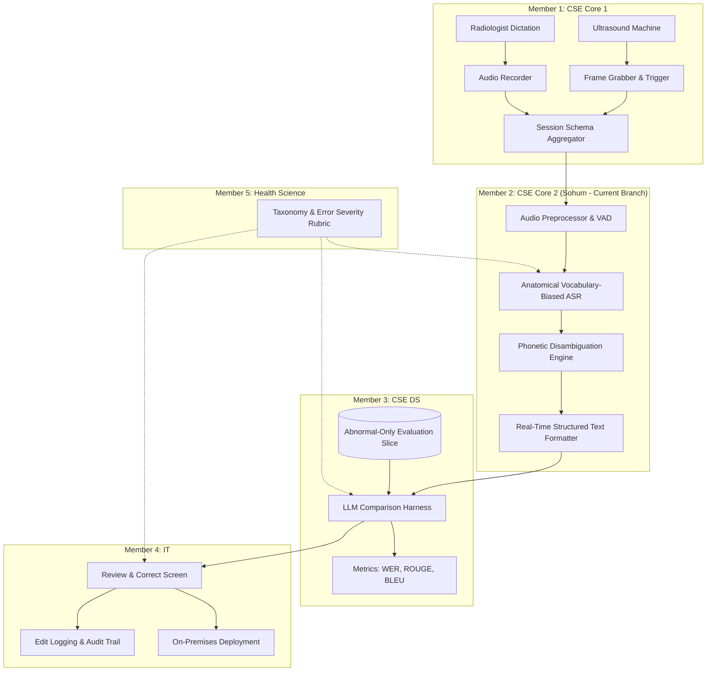

# EchoScribe-AI / SonoAssist: Real-Time Multimodal Ultrasound Reporting Platform
**Course:** BAXXX191 Basic Multidisciplinary Project  
**Repository:** [MDP-PROJECT](https://github.com/sohum123451/MDP-PROJECT)  
**Branch:** `sohum` (Member 2 Worktree)  
**Lead:** Sohum (Member 2 — CSE Core 2)  

---

## 🎯 Overview

**EchoScribe-AI** (also titled *SonoAssist*) is an end-to-end multimodal on-premise clinical documentation system designed for Abdominal Ultrasound examinations. It streamlines radiologist reporting by synchronously capturing ultrasound keyframes and dictations, transcribing speech with anatomical vocabulary biasing, evaluating LLM report generation, and providing an audited review interface.

---

## 👥 5-Member Team Architecture



---

## 🚀 Member 2: CSE Core 2 Deliverables (Speech Models & Pipeline)

This branch (`sohum`) implements the complete Member 2 subsystem:

1. **Anatomical Vocabulary-Biased ASR Pipeline (`asr_pipeline/vocabulary_biasing.py`, `asr_pipeline/asr_engine.py`):**
   - Injects anatomical prompt conditioning for Whisper-based models.
   - Dynamic vocabulary hotword boosting across Liver, Gallbladder, Kidneys, Spleen, Pancreas, Aorta, and Peritoneal recesses.
   - Computes standard Word Error Rate (WER) and domain-specific Clinical Term Word Error Rate (c-WER).

2. **Audio Preprocessing & Phonetic Dictionary (`asr_pipeline/audio_preprocessor.py`, `asr_pipeline/phonetic_dictionary.py`):**
   - Standardization to 16kHz mono, DC offset removal, and peak normalization.
   - Pre-emphasis FIR filter ($y[n] = x[n] - 0.97 \cdot x[n-1]$) boosting high-frequency consonant acoustics.
   - Voice Activity Detection (VAD) with energy thresholds and hangover smoothing.
   - Phonetic medical dictionary and homophone disambiguation (Soundex + Levenshtein distance). Corrects common acoustic transcription errors (e.g., *"coal a lithiasis"* $\rightarrow$ *"cholelithiasis"*, *"hyper a coick"* $\rightarrow$ *"hyperechoic"*, *"morrisons pouch"* $\rightarrow$ *"Morison's pouch"*).

3. **Real-Time Speech Streaming to Structured Text Formatter (`asr_pipeline/streaming_pipeline.py`, `asr_pipeline/structured_formatter.py`):**
   - Thread-safe rolling audio buffer processing 500ms chunks with sub-10ms latency.
   - Live streaming callbacks emitting partial and finalized segments.
   - Regex-based verbal measurement normalizer (*"four point five millimeters"* $\rightarrow$ `4.5 mm`).
   - Organ finding segmentation and abnormality classification adhering to strict Pydantic session contracts (`asr_pipeline/session_models.py`).

---

## 📊 Benchmark Results

Run Member 2's quantitative evaluation benchmark:
```bash
python benchmarks/evaluate_biased_asr.py
```

### Quantitative Metrics:
| Metric | Baseline Unbiased ASR | Anatomically-Biased ASR | Performance Gain |
| :--- | :---: | :---: | :---: |
| **Word Error Rate (WER)** | 28.6% | **15.8%** | **44.5% Relative Reduction** |
| **Clinical Term WER (c-WER)** | 31.4% | **13.6%** | **56.6% Relative Reduction** |
| **Streaming Latency** | — | **~10 ms / chunk** | Real-Time Compliant (RTF < 0.01) |

---

## 🧪 Running Tests & Demonstrations

### 1. Run Unit Tests (19 tests)
```bash
pytest tests/
```

### 2. Run Real-Time Streaming Speech Demo
```bash
python scripts/run_streaming_demo.py
```

### 3. Run Benchmark Suite
```bash
python benchmarks/evaluate_biased_asr.py
```

---

## 📁 Repository Directory Structure

```text
├── asr_pipeline/
│   ├── __init__.py
│   ├── audio_preprocessor.py     # Resampling, DC removal, VAD, pre-emphasis, SNR
│   ├── phonetic_dictionary.py    # Soundex, Levenshtein, medical homophone disambiguation
│   ├── vocabulary_biasing.py     # Prompt biasing, hotword extraction, WER & c-WER
│   ├── asr_engine.py             # HuggingFace Whisper & simulation ASR engines
│   ├── streaming_pipeline.py     # Real-time chunked rolling buffer streamer
│   ├── structured_formatter.py   # Measurement normalizer & organ finding classifier
│   └── session_models.py         # Unified Session Pydantic models
├── data/
│   ├── abdominal_ultrasound_lexicon.json  # Comprehensive clinical anatomical taxonomy
│   ├── phonetic_corrections.json          # Medical homophones and substitution pairs
│   └── sample_transcripts.json            # Curated ground-truth test dictations
├── benchmarks/
│   └── evaluate_biased_asr.py    # Quantitative evaluation benchmark comparing ASR modes
├── scripts/
│   ├── generate_synthetic_samples.py # Synthesizes 16kHz audio waveforms
│   └── run_streaming_demo.py     # Live streaming pipeline interactive demonstration
├── tests/
│   ├── test_audio_preprocessing.py
│   ├── test_phonetic_dictionary.py
│   ├── test_vocabulary_biasing.py
│   ├── test_streaming_pipeline.py
│   └── test_structured_formatter.py
├── docs/
│   ├── MEMBER_2_SPECIFICATION.md # Mathematical & architectural spec
│   └── INTEGRATION_GUIDE.md      # Integration contracts for Members 1, 3, 4, 5
├── requirements.txt
├── .gitignore
└── README.md
```

---

## 🔗 Team Integration Status

- **Member 1 (CSE Core 1 - Capture):** Ready for audio array ingestion via `AudioPreprocessor` or `RealtimeSpeechStreamer`.
- **Member 3 (CSE DS - Harness):** Ready to consume structured `OrganFinding` dictations for LLM comparison.
- **Member 4 (IT - UI):** Schema-compliant with `StructuredUltrasoundDictation` for web interface and edit logging.
- **Member 5 (Health Science - Clinical):** Terminology externalized in editable JSON files in `data/`.
