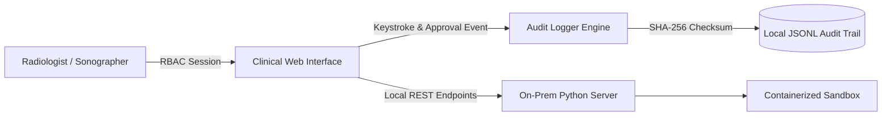

# Member 4 Technical Specification: Interface, Audit & On-Prem Deployment
**Project:** EchoScribe-AI / SonoAssist: Real-Time Multimodal Ultrasound Reporting Platform  
**Author:** Dinesh (Member 4 — IT Lead)  
**Deliverable Status:** Complete & Verified  

---

## 1. Executive Summary & Responsibilities

As **Member 4 (IT Lead)**, Dinesh is responsible for the human-machine interface, security, and hospital deployment:
- **Radiologist Review & Correct Interface:** A high-speed web application providing live keyframe viewing, audio playback, biased ASR stream comparison, and draft report correction.
- **Tamper-Evident Audit Logging:** Cryptographic SHA-256 checksum-verified change logs tracking every keystroke, user role, timestamp, and clinical justification (HIPAA § 164.312 compliance).
- **On-Premises Serving & Containerization:** Dockerized container stack ensuring zero patient data leaves the hospital firewall.
- **Review-II Interactive Presentation Suite:** Built-in slide deck mode for presenting project architecture, live hardware triggers, and benchmarking to review evaluators.

---

## 2. Security & Compliance Architecture



---

## 3. Deployment & Execution Commands

```bash
# Run unit tests
pytest tests/test_audit_logger.py

# Launch on-premises clinical review web server
python clinical_ui/server.py
# Open browser at: http://localhost:8080
```
