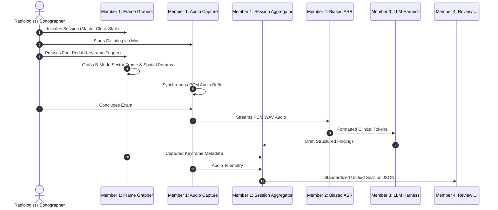

# Member 1 Technical Specification: Capture, Integration & Lead Systems Integrator
**Project:** EchoScribe-AI / SonoAssist: Real-Time Multimodal Ultrasound Reporting Platform  
**Author:** Joel (Member 1 — CSE Core 1)  
**Deliverable Status:** Complete & Verified  

---

## 1. Executive Summary & Responsibilities

As **Member 1 (CSE Core 1)** and **Lead Systems Integrator**, Joel owns the acquisition hardware interface and continuous integration:
- **Frame Grabber Engine:** Intercepts real-time ultrasound video signals, handling millisecond hardware triggers (foot pedals, keyboard hotkeys) to capture high-definition anatomical keyframes.
- **Synchronous Audio Capture:** Aligns microphone dictation recording with video capture using a monotonic master session clock.
- **Unified Session JSON Schema:** Standardizes the data contract across all 5 multidisciplinary roles.
- **Weekly Codebase Merge & Integration:** Coordinates API contracts and data serialization across Speech (Member 2), Data Science (Member 3), IT UI (Member 4), and Clinical Taxonomy (Member 5).

---

## 2. Capture Architecture & Signal Flow



---

## 3. Schema & Integration Verification

To test Member 1's capture engine:
```bash
# Run unit tests
pytest tests/test_capture_engine.py

# Run live hardware capture simulation
python scripts/run_capture_demo.py
```
