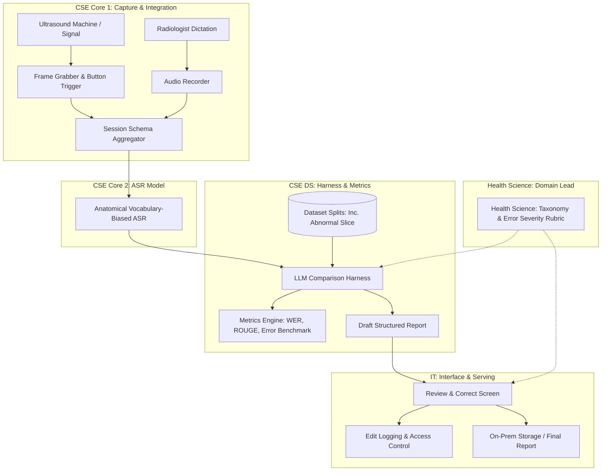
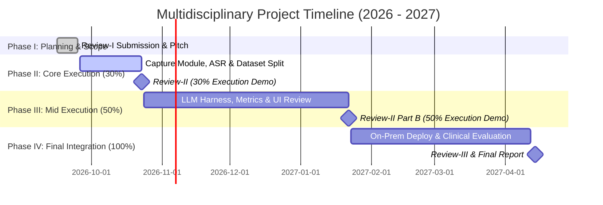

# Review-I Preparation Package: BAXXX191 Basic Multidisciplinary Project
**Target Review Date:** On or before 25th September 2026  
**Weightage:** 5 Marks  
**Mandatory Outcomes (per Rubric):** Title of the Project, Deep Understanding of Problem Statement, Objectives, and Scope.

---

## 1. Project Title Options

Choose the title option that best matches your team's preferred angle for the panel:

### Category A: Clinical & Technical Precision (Recommended)
1. **EchoScribe-AI: Multimodal Frame Capture, Vocabulary-Biased Speech Recognition, and LLM-Driven Abdominal Ultrasound Reporting**
2. **SonoAssist: Real-Time Multimodal Data Integration and LLM Structuring for Abdominal Ultrasound Documentation**
3. **Anatomically Biased Speech-to-Text and LLM-Assisted Workflow Integration for Abdominal Ultrasound**

### Category B: Data Science & AI Systems Focus
4. **End-to-End Multimodal Ultrasound Reporting Platform: From Live Capture and Biased ASR to Clinical Evaluation**
5. **Data-Driven Ultrasound Documentation: Vocabulary-Biased ASR and LLM Benchmark Harness for Clinical Workflows**

### Category C: High-Impact & Concise
6. **SonoScribe AI: Real-Time Speech and Image Structuring for Abdominal Ultrasound**
7. **OmniReport: Multimodal AI-Assisted Clinical Documentation for Abdominal Imaging**

---

## 2. Executive Summary & Problem Statement

### Clinical Background & Pain Points
Abdominal ultrasound examinations require Sonographers and Radiologists to simultaneously perform transducer manipulation, image acquisition, and verbal annotation of complex anatomical findings (e.g., liver echogenicity, gallbladder wall thickness, renal calculus dimensions). 

- **Cognitive & Physical Burden:** Radiologists spend up to 40% of their session duration manually transcribing dictated notes or typing reports into EHR/PACS systems post-examination.
- **Terminology Errors in Standard ASR:** Off-the-shelf Speech-to-Text (ASR) engines frequently misclassify anatomical jargon (e.g., confusing "hyperechoic lesion" with generic terms or misinterpreting measurement values).
- **Fragmented Workflows:** Image frame capture and audio dictations are disconnected, requiring manual matching of keyframes to written report sections.

### Problem Statement
Existing ultrasound reporting relies on fragmented manual workflows that introduce high transcription latency, potential medical record inaccuracies due to domain-unaware ASR models, and lack of standardized evaluation metrics. There is a critical need for an integrated on-premises system that synchronously captures ultrasound frames and audio, transcribes clinical dictations with anatomical vocabulary biasing, evaluates LLM summarization quality using rigorous data science benchmarks, and provides a secure, audited human-in-the-loop review interface.

---

## 3. Project Objectives & Scope

### Project Objectives
1. **Multimodal Synchronous Capture (CSE Core 1):** Build a frame-grabber and audio capture engine to record high-resolution keyframes (via hardware button/hotkey) alongside audio dictations with unified session schema management.
2. **Anatomical ASR Engine (CSE Core 2):** Fine-tune and bias an ASR engine with specialized abdominal ultrasound anatomical vocabulary to achieve low Word Error Rate (WER) on complex clinical terms.
3. **LLM Harness & Data Benchmarking (CSE DS):** Build an LLM comparison harness, curate specialized dataset splits (including an abnormal-only evaluation slice), and run quantitative evaluations (WER, ROUGE, clinical similarity metrics).
4. **Human-in-the-Loop Clinical UI (IT):** Develop an on-premise review-and-correct web interface featuring edit logging, role-based access control (RBAC), and latency tracking.
5. **Clinical Taxonomy & Validation (Health Science):** Establish an abdominal ultrasound report taxonomy, clinical error severity rubric, and ground-truth annotated dataset guided by clinical leadership.

### Project Scope
* **In-Scope:**
  * Modality: Abdominal Ultrasound (liver, gallbladder, spleen, pancreas, kidneys, aorta).
  * System Architecture: On-premise deployment, local audio/frame processing, LLM comparison harness.
  * Human Interaction: Radiologist review-and-correct interface with change tracking.
  * Dataset & Analytics: Clinical/simulated abdominal ultrasound recordings with specialized abnormal-only evaluation slice and quantitative metric pipelines.
* **Out-of-Scope:**
  * Real-time automated AI diagnosis/detection directly from video frames (this project focuses on capture, dictation, LLM structuring, and clinical evaluation).
  * Integration with proprietary closed-source PACS vendor hardware (simulated via standard frame grabber & video input).

---

## 4. Multidisciplinary 5-Member Team Responsibility Matrix

| Team Member | Department | Primary Responsibilities & Key Deliverables |
| :--- | :--- | :--- |
| **Member 1** | **CSE Core** (Core 1) | **Capture, Integration & Lead Systems Integrator** • Frame grabber module & button-press frame save trigger • Synchronous audio/mic recording pipeline • Unified session JSON schema definition • Owns weekly codebase merge and continuous integration across all 5 sub-modules |
| **Member 2** | **CSE Core** (Core 2) | **Speech Models & Pipeline Lead** • Anatomical vocabulary-biased ASR pipeline implementation • Audio preprocessing and phonetic dictionary integration • Real-time speech streaming pipeline to structured text formatter |
| **Member 3** | **CSE DS** (Data Science) | **Data Science, Harness & Evaluation Lead** • LLM model comparison harness (testing multiple open-weight LLMs) • Curation of dataset splits (training, testing, and dedicated **abnormal-only slice**) • Quantitative evaluation pipeline (WER, ROUGE, BLEU, clinical semantic similarity metrics) • Statistical error analysis & performance benchmarking |
| **Member 4** | **IT** | **Interface, Audit & On-Prem Deployment** • Review-and-correct UI screen for radiologists • Full edit-logging & audit trail system (tracking radiologist modifications) • On-premises serving infrastructure & containerized deployment (Docker) • Access control, authentication, and local data security |
| **Member 5** | **Health Science** | **Clinical Lead & Domain Expert** • Abdominal ultrasound report template taxonomy definition • Clinical error severity rubric (critical, major, minor error classification) • Ethics paperwork, IRB compliance, & radiologist scheduling • Ground-truth annotation & qualitative clinical report validation |

---

## 5. System Architecture & Workflow Overview

---

## 6. Multi-Phase Project Roadmap (BAXXX191 Schedule)

